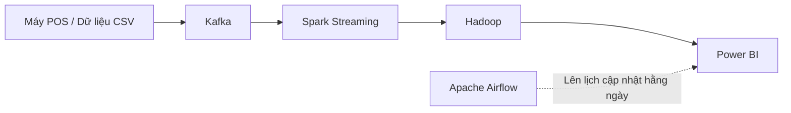

# CSC17106 – XỬ LÝ PHÂN TÍCH DỮ LIỆU TRỰC TUYẾN

## HƯỚNG DẪN THỰC HÀNH – ĐỒ ÁN MÔN HỌC

## I. Thông tin chung

| Nội dung | Thông tin |
|---|---|
| Mã số | HD10 |
| Thời lượng dự kiến | 90 tiếng |
| Deadline nộp bài | – |
| Hình thức | Vấn đáp |
| Hình thức nộp bài | Moodle |
| Giảng viên phụ trách | Phạm Minh Tú |
| Thông tin liên lạc với GV | pmtu@fit.hcmus.edu.vn |

## II. Mô tả bài toán

Một công ty tài chính muốn xây dựng hệ thống quản lý dữ liệu giao dịch thông qua thẻ tín dụng (*credit card*). Dữ liệu được phát sinh từ các máy POS đặt tại các cửa hàng mua sắm, nhà hàng và bất cứ nơi nào thanh toán không dùng tiền mặt.

Công ty muốn xây dựng hệ thống **xử lý dữ liệu theo thời gian thực**. Khi một giao dịch được phát sinh, dữ liệu được gửi đến hệ thống để kiểm tra dữ liệu có lỗi hay không:

- Nếu **`Is Fraud = Yes`**, xác định lỗi và giao dịch được xem như **không thành công**, không cần xử lý tiếp.
- Khi một giao dịch **thành công**, lưu trữ các thông tin:
  - Credit Card.
  - Ngày giao dịch theo định dạng **`dd/mm/yyyy`**.
  - Thời gian theo định dạng **`hh:mm:ss`**.
  - **Merchant Name** (nơi xảy ra giao dịch).
  - **Merchant City** (thành phố nơi giao dịch).
  - **Số tiền chuyển sang VNĐ**, theo **tỉ giá được cập nhật mỗi ngày**.

Cuối ngày, tất cả giao dịch được thống kê:

1. Tổng giá trị giao dịch theo từng **Merchant Name**.
2. Số lượng giao dịch theo từng **Merchant Name**.
3. Thống kê theo **ngày, tháng và năm**.
4. Trực quan hóa các thông tin thống kê qua công cụ hoặc hệ thống chuyên biệt.

## III. Các tình huống giả định

Giả định rằng giao dịch được phát sinh mỗi khi người dùng dùng credit card quẹt trên các máy POS tại cửa hàng mua sắm, nhà hàng,... Mỗi giao dịch được gửi qua hệ thống **Kafka theo thời gian thực**.

Sinh viên dùng **Kafka** để mô phỏng từng giao dịch được phát sinh với các thông tin được cho trước dưới dạng **CSV** (tập tin dữ liệu được đính kèm riêng theo đề).

### 1. Cấu trúc dữ liệu đầu vào

```csv
User,Card,Year,Month,Day,Time,Amount,Use Chip,Merchant Name,Merchant City,Merchant State,Zip,MCC,Errors?,Is Fraud?
```

### 2. Cách mô phỏng

- Kafka đọc từng dòng trong tập tin CSV.
- Mỗi dòng được gửi đến một **topic** đã định nghĩa trước để giả lập một giao dịch phát sinh từ máy POS.

## IV. Yêu cầu tối thiểu đồ án

### A. Công nghệ

- [ ] **1. Kafka:** Đọc dữ liệu CSV từng dòng và gửi thông tin đến **topic** đã định nghĩa trước, theo chu kỳ thời gian **ngẫu nhiên từ 1 đến 5 giây**.

- [ ] **2. Spark Streaming:** Đọc dữ liệu từ Kafka theo thời gian thực (thông tin từ Kafka được xử lý tức thì). Các xử lý bao gồm:
  - Lọc dữ liệu.
  - Biến đổi thông tin.
  - Tính toán dữ liệu.
  - Lấy **tỉ giá mới nhất** từ các website chính thống như **Vietcombank**.
  - Dùng **API** và **Web Scraping**; nếu API lỗi hoặc không ổn định thì **Web Scraping là phương án dự phòng**.

- [ ] **3. Hadoop:** Lưu trữ thông tin đã được Spark xử lý, phục vụ trực quan hóa và thống kê ở giai đoạn sau.

- [ ] **4. Power BI:** Đọc dữ liệu từ Hadoop (**dạng CSV**), thống kê dữ liệu theo mô tả bài toán và hiển thị trực quan.

- [ ] **5. Apache Airflow:** Lên lịch quá trình đọc và hiển thị dữ liệu từ Power BI để dữ liệu **luôn được cập nhật mỗi ngày**.

### B. Phân tích thời gian thực (*)

1. Thời điểm nào trong ngày có nhiều giao dịch nhất? Có khung giờ nào giao dịch bất thường không?
2. Thành phố nào có tổng giá trị giao dịch cao nhất? Có liên hệ với dân số hoặc vị trí không?
3. Merchant nào có số lượng hoặc giá trị giao dịch cao nhất?
4. Thành phố hoặc merchant nào có tỷ lệ fraud cao bất thường?
5. Người dùng nào có nhiều giao dịch liên tiếp trong thời gian ngắn?
6. Giao dịch có giá trị lớn thường xảy ra vào thời điểm nào? Ở đâu?
7. Có xu hướng nào trong các giao dịch bị fraud không? (giờ, merchant, city,...)
8. Có sự khác biệt nào giữa giao dịch ngày thường và cuối tuần?
9. Có người dùng nào bị nhiều lỗi hoặc bị gắn cờ fraud nhiều hơn mức trung bình?
10. Từ các phân tích trên, hãy đề xuất cải tiến cho hệ thống để giảm gian lận hoặc tối ưu vận hành.

> **Lưu ý:** Dấu `(*)` được giữ theo tài liệu gốc; tài liệu không giải thích thêm ý nghĩa của dấu này.

## V. Kiến trúc hệ thống (chuyển từ sơ đồ trang 3)

Sơ đồ trong đề thể hiện luồng chính: **Máy POS / dữ liệu CSV → Kafka → Spark Streaming → Hadoop → Power BI**, với **Apache Airflow** phục vụ việc lập lịch cập nhật dữ liệu.



**Ghi chú:** Phần kiến trúc trên là bản biểu diễn Markdown/Mermaid của hình trong PDF, không bổ sung công nghệ mới.

---
